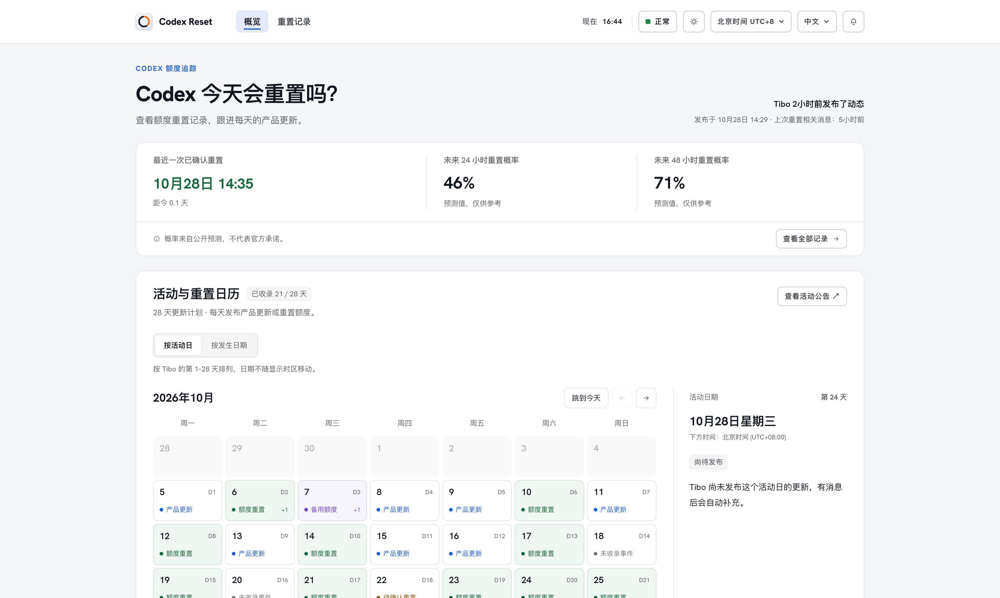

# Codex Reset

追踪 OpenAI Codex 的额度重置：最近一次已确认的全局重置、未来 24/48 小时重置概率、28 天更新计划（Day 1–28）、完整重置记录与 Codex 服务状态。中文为主，英文在 `/en/` 下。

**线上地址：<https://codex-reset.opentunnel.asia/>**



> 个人项目，与 OpenAI 无关。只读公开数据：不登录任何账号，也读不到任何人的个人额度。

## 为什么做这个

Tibo（[@thsottiaux](https://x.com/thsottiaux)）会用 X 帖子宣布 Codex 的全局额度重置。问题是「宣布」和「真的生效」之间经常有时间差，而「我的 5 小时窗口到期了」又和「全局重置」完全是两件事。

所以这个站把状态拆成三种，分开记录：

| 状态 | 含义 |
| --- | --- |
| 公告 announced | 帖子里说要重置 |
| 待确认 pending | 还没有观测到额度实际刷新 |
| 已确认 verified | 监测到刷新，或有第二个独立来源 |

不会把一条预告当成已经发生的重置。

## 页面

| 路径 | 内容 |
| --- | --- |
| `/` 概览 | 最近一次重置、24/48 小时概率、可切换月份的重置日历、选中日期详情、分类动态 |
| `/timeline` 重置记录 | 重置间隔、分类筛选、时区切换、可排序的历史记录 |
| `/plan` 28 天计划 | Tibo 的 Day 1–28 逐日对照：哪天是重置、哪天只是产品更新 |
| `/archive` 按月归档 | 每月一页的重置记录 |
| `/status` 服务状态 | Codex 各入口状态与故障记录 |
| `/vigil` 一起等重置 | 等待人数、历史重置时段、常见问题 |
| `/about` 关于 | 数据来源、判定口径、更新频率、已知限制 |
| `/en/*` | 以上页面的英文版 |

## 技术结构

- **零依赖、无构建**：Node 18+ 直接运行，静态资源就是 HTML / CSS / 原生 JS。
- **服务端渲染**：每个路由输出各自的 `<title>`、`description`、`canonical`、`hreflang`、Open Graph 与 JSON-LD，首屏正文直接写进 HTML，不执行 JS 也能读到内容——搜索引擎和 AI 爬虫看到的是完整页面。
- **反向代理上游 API**：`/api/*` 转发到上游，站点本身不存数据。
- **部署**：推送到 `main` 后由 GitHub Actions 检查、构建镜像、blue-green 切换并核对公网版本；也可 `npm run deploy` 手动发布。见 [DEPLOY.md](DEPLOY.md)。
- **SEO / GEO**：`robots.txt`、`sitemap.xml`、`llms.txt`、结构化数据（`Dataset` / `FAQPage` / `Article` / `Organization`）、面向答案引擎的「快速回答」段落。细节见 [docs/SEO.md](docs/SEO.md)。

```bash
npm start            # http://localhost:4173
npm run check        # 模块语法、日历日期与记录状态
npm run check:server # HTTP 路由、健康检查、异常请求隔离
npm run check:seo    # 23 条可抓取路由、robots、sitemap、结构化数据、404 与跳转
npm run check:deploy # 发布验证器
```

## 数据来源与口径

- 上游：Tibo 的公开 X 帖子、OpenAI Status、公开预测数据。
- 时间默认按北京时间（UTC+8）展示，可切换时区；活动日按美国太平洋时间编号，不随访问者时区变化。
- 概率是公开信号与历史节奏的推算，**不代表 OpenAI 的承诺**。
- 上游接口不可用时，页面保留最后一次数据并标注可能过期。

## 许可

[MIT](LICENSE)。欢迎指出判定口径上的错误——尤其是「某天到底算不算一次重置」这类边界情况。
